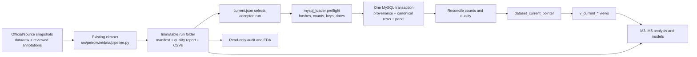
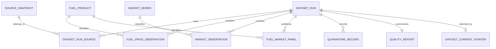

# M2 data and database workflow

This guide connects the work M1–M2 have done: source files, the accepted v3 pipeline, quality checks, MySQL publication, and the dataset M3–M5 consume. The accepted CSV contract remains the shared handoff; MySQL provides queryable, versioned storage.

## End-to-end flow



**Why two storage forms?** CSV v3 is portable and easy for the whole team to review or load in Python. MySQL adds foreign keys, indexed queries, run history, and safe current-run selection. Neither one should silently replace the other; both refer to the same `run_id` and source hashes.

## Table map and grain

| Table | One row means | Key idea |
|---|---|---|
| `dataset_run` | One published processing run | `run_id` identifies the exact build and status. |
| `source_snapshot` | One source file version | `snapshot_id` is its SHA-256; keep attribution and retrieval times. |
| `dataset_run_source` | One source used by one run | Links a run to each exact source snapshot. |
| `fuel_product`, `market_series` | One controlled product/series definition | Reference IDs prevent spelling variations. |
| `fuel_price_observation` | One product price event | Product + effective local time + source snapshot. |
| `market_observation` | One Brent or FX series/date/source row | Missing observations are explicit status + SQL `NULL`. |
| `fuel_market_panel` | One valid fuel event with prior market context | Retains target and feature provenance/date/age. |
| `fund_annotation` | One verified product/date fund annotation | A blank/unverified annotation is not inserted as zero. |
| `quarantine_record` | One rejected source row | Auditable, never a target or feature. |
| `quality_report` | One machine-readable report per run | Counts, checks, and publication status. |
| `dataset_current_pointer` | Which validated run consumers see by default | Singleton row; changed only after reconciliation. |

## Keys and relationships



`run_id` makes observations from different processed versions coexist. Foreign keys from observation rows to `(run_id, snapshot_id)` ensure a row cannot claim a source snapshot that was not linked to that run. The current views filter by the singleton pointer. For reproducible work, query by a pinned `run_id` instead of relying on “current” after the fact.

## Automated procedure for source refresh (T14)

The source refresh is completely automated via the T14 orchestrator (`petrotwin.collectors.runner`) and scheduled via Cron on the server. The workflow guarantees zero manual data entry, atomicity, validation gates, and seamless database pointer transitions:

1. **Automated scheduled collection:** Cron triggers the individual collectors (`brent.py`, `fx.py`, `domestic_fuel.py`) or the full orchestrator `python -m petrotwin.collectors.runner`.
2. **Append-only raw preservation:** New observations are appended atomically to `data/raw/*.csv` with ISO UTC extraction timestamps. Previous raw records are never modified in place.
3. **Automated validation pipeline:** The orchestrator automatically invokes `src/petrotwin/data/pipeline.py` when new rows are detected. It checks schema fingerprints, keys, temporal order, and leakage constraints (`brent_observation_date < event_date`), generating an immutable run with checksums, manifest, and quality report.
4. **Automated transactional publication:** If `PETROTWIN_DB_HOST` is configured, the orchestrator executes `src/petrotwin/data/mysql_loader.py --load` in a single ACID transaction.
5. **Atomic pointer switch:** The database singleton pointer `dataset_current_pointer` is updated only after all validation and reconciliation gates pass. Any failure triggers a clean rollback, leaving existing serving views (`v_current_*`) intact and unaffected.
6. **Continuous monitoring:** Every scheduled run appends structured JSON diagnostics to `logs/collector_run.log` for operational observability. See [T14 Runbook](../reports/T14-update-runbook.md) for log monitoring and alert details.

The initial schema migration `001_initial_schema.sql` is for a fresh database only. Do not run it again against the populated project database. `002_seed_reference_data.sql` uses `INSERT IGNORE` and is safe to reapply.

## Safe ways to query

Check the selected run and its source versions:

```sql
SELECT r.run_id, r.schema_version, r.pipeline_version, r.publication_status,
       r.created_at_utc
FROM dataset_current_pointer AS p
JOIN dataset_run AS r ON r.run_id = p.run_id
WHERE p.singleton_id = 1;

SELECT s.source_id, s.raw_filename, s.sha256, s.source_row_count,
       s.retrieved_at_utc_min, s.retrieved_at_utc_max
FROM dataset_current_pointer AS p
JOIN dataset_run_source AS rs ON rs.run_id = p.run_id
JOIN source_snapshot AS s ON s.snapshot_id = rs.snapshot_id
ORDER BY s.source_id;
```

Inspect the event panel through the read-only view:

```sql
SELECT product_id, COUNT(*) AS events,
       MIN(DATE(effective_at_local)) AS first_event,
       MAX(DATE(effective_at_local)) AS last_event,
       SUM(brent_usd_per_barrel IS NULL) AS missing_brent,
       SUM(usd_vnd_rate IS NULL) AS missing_fx
FROM v_current_fuel_market_panel
GROUP BY product_id
ORDER BY events DESC;

SELECT product_id, effective_at_local, price_value, unit_code,
       brent_observation_date, brent_age_days,
       fx_observation_date, fx_age_days
FROM v_current_fuel_market_panel
WHERE product_id = 'gasoline_e5_ron92_ii'
ORDER BY effective_at_local DESC
LIMIT 20;
```

To inspect rejected data, use `quarantine_record` with the current `run_id`; do not join it into the modeling panel. To compare a historical run, replace the view with a direct table query filtered by its pinned `run_id`.

## Practice path

Run these read-only commands in order in Workbench: `SELECT VERSION();`, `SELECT DATABASE();`, `SHOW FULL TABLES;`, inspect `dataset_current_pointer`, query one `v_current_fuel_market_panel` product, then group by product as above. Next, trace one row's `target_snapshot_id` to `dataset_run_source` and `source_snapshot`. This teaches table grain, primary keys, foreign keys, NULL semantics, views, and provenance without changing data.

See [MySQL operations](../database/mysql/README.md), [schema acceptance](../reports/mysql-schema-acceptance.md), and [run reconciliation](../reports/mysql-reconciliation.md) for the exact local setup and evidence.
