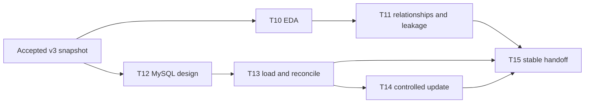

# M2 work plan — EDA, MySQL, and stable data handoff

## Goal

Turn the accepted `petrotwin-data-v3` snapshot into a documented, checked, reproducible data foundation for M3–M5. Keep the accepted CSV contract intact while adding MySQL as a storage and handoff target.

**Database target:** MySQL 26.7 with InnoDB. The migration is a draft until it is applied and reconciled against a reachable MySQL 26.7 server.

**Input of record:** resolve `data/processed/current.json`, then read the immutable run it points to. The audited baseline is `28b22922e761cb08a8d8`; do not hard-code that run ID in reusable code.

## Work sequence

| Task | Work | Inputs / dependency | Deliverable | Acceptance evidence |
|---|---|---|---|---|
| **T10 — EDA** | Profile event coverage, product coverage, price levels and changes, time gaps, missingness, and source quality. | Accepted v3 panel, market observations, quality report. | `notebooks/01_eda/01_fuel_market_eda.ipynb`; `reports/eda-summary.md`. | Notebook runs from the repository root; captures run ID and date range; summary reports counts and limitations; no source or processed data is mutated. |
| **T11 — relationships and leakage** | Explore associations between fuel-price changes and strictly prior Brent/FX data; identify sparse products, missingness, and features that could leak future information. | T10 snapshot and explicit target/horizon/as-of definition agreed with M3. | EDA relationship section and a documented feature/leakage decision in `reports/eda-summary.md` or `docs/`. | Every feature has an observation date earlier than the forecast origin; correlations are labelled exploratory, not causal; sparse series and excluded fields are stated. |
| **T12 — MySQL design** | Map the v3 file grains, provenance, quality outputs, run versioning, and current-run selection to relational tables and keys. | v3 data dictionary and acceptance report. | `database/mysql/001_initial_schema.sql`; `database/mysql/002_seed_reference_data.sql`; `database/mysql/README.md`. | Foreign keys and unique keys express the documented grains; every table is InnoDB; timestamps have explicit timezone handling; source hashes and all retrieval times are retained; migration applies on MySQL 26.7. |
| **T13 — load and reconcile** | Implement an idempotent CSV-to-MySQL loader with staging/transaction handling and compare database results against the accepted manifest and quality report. | T12 migration; a reachable MySQL 26.7 instance; accepted v3 run. | Loader under `src/petrotwin/data/` or `scripts/`; reconciliation report under `reports/`. | Output row counts and checksums match manifest expectations; keys have no duplicates; nulls and quarantined rows retain their meaning; failed loads leave the current-run pointer unchanged; credentials come from environment/secret storage. |
| **T14 — controlled update** | Automate snapshot intake, validation, load, and publication for an approved source refresh. | T13 loader and source/update policy. | Reusable command or scheduled workflow, configuration under `configs/`, run log/quality report. | Repeatable, observable, and safe to rerun; verifies checksums and quality gates; publishes only after validation; does not fetch or republish data from sources whose access/reuse terms are unverified. |
| **T15 — stable handoff** | Publish the final data contract, update instructions, database access pattern, and known limitations for M3–M5. | T10–T14 decisions and reconciled accepted run. | Updated `docs/DATA_INTERFACE.md`, `docs/DATA_DICTIONARY.md`, and handoff/acceptance note under `reports/`. | A teammate can resolve the current run, query the panel, identify provenance, reproduce counts, and understand missingness/quarantine without relying on M2's local environment. |

## Dependency flow



T10/T11 are the first priority. T12 can be reviewed alongside them, but T13 depends on an approved schema and an available server. T15 is the final integration gate.

## Repository layout for M2

| Path | Purpose |
|---|---|
| `docs/M2_WORKPLAN.md` | Task sequence, dependencies, deliverables, and acceptance gates. |
| `notebooks/01_eda/` | Reproducible exploration only; keep stable reusable transformations in package code. |
| `reports/eda-summary.md` | Human-readable findings, caveats, and handoff decisions from T10/T11. |
| `database/mysql/` | MySQL migration and operational/schema notes for T12. |
| `src/petrotwin/data/` | T13 loader and reusable validation/reconciliation logic. |
| `configs/` | Non-secret update and database configuration; secrets stay outside Git. |
| `reports/` | T13 reconciliation, T14 run evidence, and T15 acceptance/handoff records. |

Keep generated datasets and credentials out of Git. Use the CSV v3 interface as the team contract even after MySQL is added, so M3–M5 can consume the same accepted fields and provenance.

## Current working state

- T10/T11 notebook and summary exist as local drafts and need team review against the agreed model target and forecast horizon.
- T12 schema and README exist as a local draft targeting MySQL 26.7 / InnoDB; server-side application has not yet been confirmed.
- T13–T15 remain to be implemented and accepted.
- No M2 changes have been pushed to GitHub.

## Original team-sheet schedule

Status and due dates below reflect the sheet snapshot previously reviewed; update the sheet with the team before treating them as current.

| Task | Due date in sheet | Status in sheet |
|---|---|---|
| T10 | 2026-10-27 | In progress |
| T11 | 2026-10-28 | In progress |
| T12 | 2026-10-29 | In progress |
| T13 | 2026-10-30 | Not started |
| T14 | 2026-10-31 | Not started |
| T15 | 2026-11-01 | Not started |


## File map: what exists and what remains

### Already present in this checkout

| File/folder | Role | State |
|---|---|---|
| `docs/M2_WORKPLAN.md` | M2 roadmap and runbook | Added in this working branch |
| `docs/DATA_INTERFACE.md`, `docs/DATA_DICTIONARY.md` | CSV v3 contract and field meanings | Existing team contract; change only with agreement |
| `data/processed/current.json`, `data/processed/runs/<run_id>/` | Accepted immutable run and artifacts | T10–T13 input; never hand-edit |
| `notebooks/01_eda/01_fuel_market_eda.ipynb`, `notebooks/01_eda/README.md` | EDA workflow | T10/T11 draft |
| `reports/eda-summary.md` | EDA findings and caveats | T10/T11 draft; T11 needs target/horizon agreement with M3 |
| `database/mysql/001_initial_schema.sql`, `database/mysql/002_seed_reference_data.sql`, `database/mysql/README.md` | MySQL schema, reference IDs, and publication design | T12 draft; server-side migration unverified |
| `src/petrotwin/data/pipeline.py` | Existing M1 raw-to-processed pipeline | Reuse for T14; do not create a second cleaner |
| `reports/data-foundation-acceptance.md` | M1 snapshot audit | Read as input; preserve the audit trail |

### Planned additions by task

```text
src/petrotwin/data/
  mysql_loader.py          # T13: idempotent transactional import of one accepted run
  mysql_reconcile.py       # T13: compare database counts/keys with manifest and QA report

tests/integration/
  test_mysql_loader.py     # T13: integration checks against a disposable test schema

.env.example               # T13: variable names only; never put real credentials here
pyproject.toml             # T13: optional MySQL connector dependency
reports/
  mysql-reconciliation.md  # T13: server version, counts, keys, null/quarantine checks
  data-handoff.md          # T15: steps M3–M5 use to find and consume the dataset
configs/
  data-refresh.example.yaml # T14, only if refresh needs versioned non-secret settings
```

No separate `scripts/` wrapper is planned initially: the repository already runs Python modules directly. Do not create a second update pipeline; T14 should reuse `petrotwin.data.pipeline` after an approved source snapshot is placed locally.

## Working procedure in VS Code

1. **Open the checkout and branch.** Open `E:\KHDL\Đồ án\PetroTwin-`; confirm Source Control shows `codex/m2-eda`. Keep `main` as the M1 baseline. Do not commit credentials or generated source data.
2. **Prepare Python once.** From the integrated terminal at the repo root, create `.venv`, activate it in PowerShell, run `python -m pip install -e "[eda,dev]"`, then select `.venv` as the VS Code interpreter and notebook kernel.
3. **Read the data contract.** Review `docs/DATA_INTERFACE.md`, `docs/DATA_DICTIONARY.md`, and `reports/data-foundation-acceptance.md`. Resolve `data/processed/current.json` and read its pointed-to run. Do not hard-code the run ID in reusable code.
4. **Finish T10.** Run `notebooks/01_eda/01_fuel_market_eda.ipynb` from this checkout. Confirm it prints the active run ID and date span. Review results and update `reports/eda-summary.md` if evidence differs.
5. **Agree T11's modeling question with M3.** Define the target, forecast origin, and horizon. Check every Brent/FX feature date is strictly before the origin; document leakage exclusions and sparse-series limits in the summary.
6. **Verify T12 on MySQL 26.7.** Start/install the agreed server, check `SELECT VERSION();`, and apply the migration to a disposable development schema. Fix SQL errors and confirm tables use InnoDB before accepting T12.
7. **Implement T13 after schema approval.** Add environment variable names to `.env.example`; keep actual passwords in ignored `.env` or a secret store. Load the accepted run without rewriting CSVs, reconcile counts and keys to the manifest/quality report, and update the current pointer only after all checks pass.
8. **Do T14 with approved snapshots.** Reuse the existing pipeline to validate and publish a new immutable run. Do not automate source downloads until reuse terms, attribution, and update behavior are approved. Preserve logs and the old current pointer on failure.
9. **Finish T15 and hand off.** Update contract docs only for agreed changes, write `reports/data-handoff.md`, and ask a teammate to follow the instructions using only the repo and accepted snapshot.

## Concepts to keep in mind

- **Grain:** a fuel-price event, a market-series observation, and a joined panel row have different keys.
- **Provenance:** `run_id`, `snapshot_id`, SHA-256, source URL, and retrieval timestamps identify which data produced a row.
- **Missing is not zero:** blank cells map to SQL `NULL`; quarantine rows remain auditable but never become valid targets/features.
- **No future data:** market observation dates must precede the prediction origin; do not use the final event price to predict itself.
- **Safe publication:** load and reconcile a new run first; move `dataset_current_pointer` only after every gate passes.
- **Shared interface:** M3–M5 can continue using CSV v3 while MySQL is brought online and reconciled.

