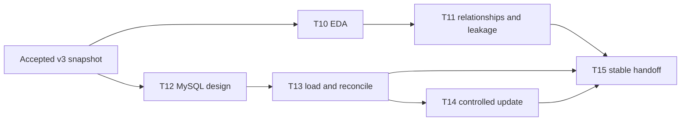

# M2 work plan — EDA, MySQL, and stable data handoff

## Goal

Turn the accepted `petrotwin-data-v3` snapshot into a documented, checked, reproducible data foundation for M3–M5. Keep the accepted CSV contract intact while adding MySQL as a storage and handoff target.

**Database target:** MySQL 26.10 with InnoDB. The initial schema and reference seeds are applied locally; accepted run `28b22922e761cb08a8d8` is loaded and reconciled.

**Input of record:** resolve `data/processed/current.json`, then read the immutable run it points to. The audited baseline is `28b22922e761cb08a8d8`; do not hard-code that run ID in reusable code.

## Work sequence

| Task | Work | Inputs / dependency | Deliverable | Acceptance evidence |
|---|---|---|---|---|
| **T10 — EDA** | Profile event coverage, product coverage, price levels and changes, time gaps, missingness, and source quality. | Accepted v3 panel, market observations, quality report. | `notebooks/01_eda/01_fuel_market_eda.ipynb`; `reports/eda-summary.md`. | Notebook runs from the repository root; captures run ID and date range; summary reports counts and limitations; no source or processed data is mutated. |
| **T11 — relationships and leakage** | Explore associations between fuel-price changes and strictly prior Brent/FX data; identify sparse products, missingness, and features that could leak future information. | T10 snapshot and explicit target/horizon/as-of definition agreed with M3. | EDA relationship section and a documented feature/leakage decision in `reports/eda-summary.md` or `docs/`. | Every feature has an observation date earlier than the forecast origin; correlations are labelled exploratory, not causal; sparse series and excluded fields are stated. |
| **T12 — MySQL design** | Map the v3 file grains, provenance, quality outputs, run versioning, and current-run selection to relational tables and keys. | v3 data dictionary and acceptance report. | `database/mysql/001_initial_schema.sql`; `database/mysql/002_seed_reference_data.sql`; `database/mysql/README.md`. | Foreign keys and unique keys express the documented grains; every table is InnoDB; timestamps have explicit timezone handling; source hashes and all retrieval times are retained; migration applies on MySQL 26.10. |
| **T13 — load and reconcile** | Implement an idempotent CSV-to-MySQL loader with staging/transaction handling and compare database results against the accepted manifest and quality report. | T12 migration; a reachable MySQL 26.10 instance; accepted v3 run. | Loader under `src/petrotwin/data/` or `scripts/`; reconciliation report under `reports/`. | Output row counts and checksums match manifest expectations; keys have no duplicates; nulls and quarantined rows retain their meaning; failed loads leave the current-run pointer unchanged; credentials come from environment/secret storage. |
| **T14 — controlled update** | Automate snapshot intake, validation, load, and publication for an approved source refresh. | T13 loader and source/update policy. | Reusable command or scheduled workflow, configuration under `configs/`, run log/quality report. | Repeatable, observable, and safe to rerun; verifies checksums and quality gates; publishes only after validation; does not fetch or republish data from sources whose access/reuse terms are unverified. |
| **T15 — stable handoff** | Publish the final data contract, update instructions, database access pattern, and known limitations for M3–M5. | T10–T14 decisions and reconciled accepted run. | Updated `docs/DATA_INTERFACE.md`, `docs/DATA_DICTIONARY.md`, and handoff/acceptance note under `reports/`. | A teammate can resolve the current run, query the panel, identify provenance, reproduce counts, and understand missingness/quarantine without relying on M2's local environment. |

## Dependency flow

T10/T11 are the first priority. T12 can be reviewed alongside them, but T13 depends on an approved schema and an available server. T15 is the final integration gate.

### Required data-preparation gate before T10/T11

Before starting exploratory analysis, first reproduce or resolve the accepted processed snapshot, then review `notebooks/00_data_preparation/01_preprocessing_quality_audit.ipynb`. The existing `src/petrotwin/data/pipeline.py` is the one raw-to-canonical cleaner; do not create a second cleaner or edit raw/published files by hand. The audit notebook profiles schemas, missingness, keys, numeric ranges, event/calendar gaps, row counts, hashes, quarantine, and point-in-time joins, and visualizes these diagnostics without testing fuel-price relationships to Brent/FX. Resolve FAIL checks and document WARN items before proceeding to T10/T11. Outlier flags are review prompts, never automatic deletion or imputation.

## Repository layout for M2

| Path | Purpose |
|---|---|
| `docs/M2_WORKPLAN.md` | Task sequence, dependencies, deliverables, and acceptance gates. |
| `docs/M2_DATABASE_GUIDE.md` | End-to-end source → pipeline → MySQL → M3–M5 diagram, table grains, safe refresh steps, and SQL practice path. |
| `notebooks/01_eda/` | Reproducible exploration only; keep stable reusable transformations in package code. |
| `notebooks/00_data_preparation/` | Pre-EDA profiling, cleaning-output reconciliation, quality gates, and data-shape visualizations. |
| `reports/eda-summary.md` | Concise EDA findings and caveats, with seven linked diagnostic figures. |
| `database/mysql/` | MySQL migrations, loader operations, and read-only reconciliation query for T12/T13. |
| `src/petrotwin/data/` | Existing M1 cleaning pipeline, read-only quality audit, and T13 loader. |
| `configs/` | Non-secret update and database configuration; secrets stay outside Git. |
| `reports/` | T12 schema acceptance, T13 reconciliation, T14 run evidence, and T15 acceptance/handoff records. |

Keep generated datasets and credentials out of Git. Use the CSV v3 interface as the team contract even after MySQL is added, so M3–M5 can consume the same accepted fields and provenance.

## Current working state

- T10 notebook and seven diagnostic figures were regenerated against accepted run `28b22922e761cb08a8d8`; detailed metrics and findings are in `reports/eda-summary.md`. The pre-EDA audit reports 0 FAIL and 1 WARN. T11 remains exploratory until M3 agrees on the target, forecast origin, horizon, and as-of cutoff.
- T12 schema is applied on local MySQL 26.10.0 and verified: 12/12 base tables use InnoDB; seed counts are 10 fuel products and 2 market series. Evidence is in `reports/mysql-schema-acceptance.md`.
- T13 loader, database load, and reconciliation are complete for run `28b22922e761cb08a8d8`. Live MySQL 26.10.0 counts match the accepted outputs; NULL/quarantine semantics, current pointer, and strict-prior panel checks passed. Evidence is in `reports/mysql-reconciliation.md`.
- The team sheet currently marks T14 and T15 complete, but the repo's planned refresh/handoff acceptance artifacts still need review; source reuse terms also remain unverified. Reconcile the team's status with the actual deliverables before treating M2 as fully closed.

## Original team-sheet schedule

Status and due dates below reflect the sheet snapshot previously reviewed; update the sheet with the team before treating them as current.

| Task | Due date in sheet | Status in sheet |
|---|---|---|
| T10 | 2026-10-27 | In progress |
| T11 | 2026-10-28 | In progress |
| T12 | 2026-10-29 | In progress |
| T13 | 2026-10-30 | Not started |
| T14 | 2026-10-31 | Not started |
| T15 | 2026-11-01 | Not started |

## File map: what exists and what remains

### Already present in this checkout

| File/folder | Role | State |
|---|---|---|
| `docs/M2_WORKPLAN.md` | M2 roadmap and runbook | Added in this working branch |
| `docs/DATA_INTERFACE.md`, `docs/DATA_DICTIONARY.md` | CSV v3 contract and field meanings | Existing team contract; change only with agreement |
| `data/processed/current.json`, `data/processed/runs/<run_id>/` | Accepted immutable run and artifacts | T10–T13 input; never hand-edit |
| `notebooks/01_eda/01_fuel_market_eda.ipynb`, `notebooks/01_eda/README.md` | EDA workflow with six code cells and seven figures | T10 complete; T11 screening draft awaits M3 modeling decisions |
| `reports/eda-summary.md` | Concise EDA findings and caveats with linked charts | T10 draft complete; T11 needs target/horizon/as-of agreement with M3 |
| `database/mysql/001_initial_schema.sql`, `database/mysql/002_seed_reference_data.sql`, `database/mysql/README.md` | MySQL schema, reference IDs, and loader operations | T12 applied and verified on MySQL 26.10.0 |
| `database/mysql/003_reconcile_run.sql`, `reports/mysql-reconciliation.md`, `reports/mysql-schema-acceptance.md` | Read-only live reconciliation and T12/T13 evidence | Applied and reconciled locally |
| `src/petrotwin/data/mysql_loader.py` | Transactional loader for an accepted immutable run | Implemented and used for T13 |
| `src/petrotwin/data/quality_audit.py`, `notebooks/00_data_preparation/` | Pre-EDA profiles, gates, and data-shape charts | Audit run before T10; 0 FAIL, 1 WARN |
| `docs/M2_DATABASE_GUIDE.md` | Database concepts, end-to-end flow, safe refresh, and SQL practice | Added; team review still useful |
| `src/petrotwin/data/pipeline.py` | Existing M1 raw-to-processed pipeline | Reuse for T14; do not create a second cleaner |
| `reports/data-foundation-acceptance.md` | M1 snapshot audit | Read as input; preserve the audit trail |

### Remaining review and handoff items

The team sheet currently marks T14 and T15 complete, while source reuse terms are still unverified and this checkout does not yet contain an automated refresh configuration or a separate teammate acceptance record. Confirm with task owners whether the sheet status refers to work outside this checkout. Do not automate source downloads until reuse terms are approved. Use `docs/M2_DATABASE_GUIDE.md` as the starting handoff; reuse `petrotwin.data.pipeline` for any approved refresh rather than creating another cleaner.

## Working procedure in VS Code

1. **Open the checkout and branch.** Open `E:\KHDL\Đồ án\PetroTwin-`; confirm Source Control shows `codex/m2-eda`. Keep `main` as the M1 baseline. Do not commit credentials or generated source data.
2. **Prepare Python once.** From the integrated terminal at the repo root, create `.venv`, activate it in PowerShell, run `python -m pip install -e "[eda,dev]"`, then select `.venv` as the VS Code interpreter and notebook kernel.
3. **Read the data contract.** Review `docs/DATA_INTERFACE.md`, `docs/DATA_DICTIONARY.md`, and `reports/data-foundation-acceptance.md`. Resolve `data/processed/current.json` and read its pointed-to run. Do not hard-code the run ID in reusable code.
4. **T10 delivered.** The notebook and seven figures were regenerated from the current pointer. Review `reports/eda-summary.md` and the notebook outputs.
5. **Agree T11's modeling question with M3.** Define the target, forecast origin, and horizon. Check every Brent/FX feature date is strictly before the origin; document leakage exclusions and sparse-series limits in the summary.
6. **T12 verified.** MySQL 26.10.0 schema and 12 InnoDB tables are recorded in `reports/mysql-schema-acceptance.md`. Do not rerun the create-table migration on a database with data; use a disposable schema for future migration rehearsals.
7. **T13 delivered.** The loader and environment variable names are present; the accepted run was loaded and reconciled. See `database/mysql/README.md` and `reports/mysql-reconciliation.md`.
8. **Do T14 with approved snapshots.** Reuse the existing pipeline to validate and publish a new immutable run. Do not automate source downloads until reuse terms, attribution, and update behavior are approved. Preserve logs and the old current pointer on failure.
9. **T15 review.** Use `docs/M2_DATABASE_GUIDE.md` and `reports/mysql-reconciliation.md`; confirm with M3–M5 whether a separate data-handoff note and teammate dry run are still expected.

## Concepts to keep in mind

- **Grain:** a fuel-price event, a market-series observation, and a joined panel row have different keys.
- **Provenance:** `run_id`, `snapshot_id`, SHA-256, source URL, and retrieval timestamps identify which data produced a row.
- **Missing is not zero:** blank cells map to SQL `NULL`; quarantine rows remain auditable but never become valid targets/features.
- **No future data:** market observation dates must precede the prediction origin; do not use the final event price to predict itself.
- **Safe publication:** load and reconcile a new run first; move `dataset_current_pointer` only after every gate passes.
- **Shared interface:** M3–M5 can continue using CSV v3 while MySQL is brought online and reconciled.
