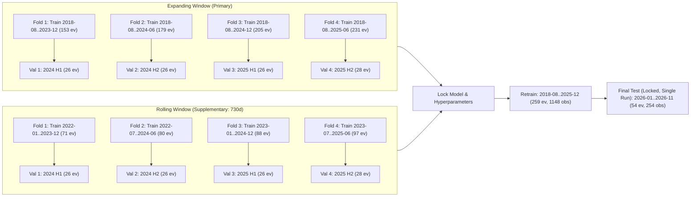

# T21: Time Series Validation Strategy

> **Trạng thái**: Hoàn thiện đặc tả chiến lược kiểm định chuỗi thời gian (M3 – T21)
> **Cấu hình tái lập**: [`configs/validation.yaml`](../configs/validation.yaml)
> **Tài liệu liên quan**: [`docs/T20_Time_Series_Problem_Specification.md`](T20_Time_Series_Problem_Specification.md), [`configs/default.yaml`](../configs/default.yaml), [`configs/collectors.yaml`](../configs/collectors.yaml)

---

## 1. Mục tiêu và Phạm vi

Tài liệu này thiết lập **chiến lược kiểm định chuỗi thời gian (Time Series Validation Strategy)** cho hệ thống dự báo giá bán lẻ xăng dầu và phân tích Quỹ Bình ổn giá (BOG) **PetroTwin**, bảo đảm:

1. Tuân thủ nghiêm ngặt thứ tự thời gian (**chronological order**), không phá vỡ cấu trúc sự kiện điều hành giá.
2. Ngăn chặn tuyệt đối **data leakage** tại mọi `Forecast Origin` giữa hai kỳ điều hành giá.
3. So sánh công bằng **Naive Persistence Baseline**, **SARIMAX** và **XGBoost** trên cùng tập fold, cùng `Forecast Origin` và cùng tập quan sát tương đương.
4. Cách ly hoàn toàn tập **Final Test** khỏi quá trình tuning và lựa chọn mô hình.
5. Xử lý trung thực và nhất quán bài toán phân loại **BOG 3 lớp** trong điều kiện dữ liệu nhãn lịch sử còn hạn chế.

> [!NOTE]
> Tài liệu này quy định kiến trúc kiểm định và cấu hình tái lập trong [`configs/validation.yaml`](../configs/validation.yaml); việc huấn luyện mô hình SARIMAX/XGBoost và chạy pipeline sản xuất không nằm trong phạm vi T21.

---

## 2. Cơ sở Dữ liệu Thực tế (Canonical Snapshot)

Các mốc cắt (cutoffs) và số lượng fold trong T21 được xác định trực tiếp từ dữ liệu canonical hiện có trên nhánh `feature/m3-t21-validation-strategy` (không chọn tỷ lệ 70/15/15 một cách máy móc):

| Nguồn / Bảng dữ liệu | Khoảng thời gian | Số lượng bản ghi hợp lệ | Ghi chú kiểm định |
|---|---|---|---|
| **Giá xăng dầu nội địa** (`data_price_petro.csv` + `comeco_fuel_prices.csv`) | `2018-08-22` → `2026-11-12` | **313** sự kiện (`effective_at_local`), **1.402** quan sát hợp lệ | Đã loại 64 dòng giá `0` (`quarantined`); `fuel_oil_3s` có 0 dòng hợp lệ; 4 sản phẩm COMECO hiện hành có mặt đến `2026-11-12`. |
| **Giá dầu thô Brent** (`brent_crude_prices.csv`) | `2018-08-22` → `2026-11-11` | **2.146** ngày giao dịch | Tần suất ngày giao dịch; tham gia nối theo quy tắc `observation_date < forecast_origin_date`. |
| **Tỷ giá USD/VND** (`usd_vnd_rates.csv`) | `2018-08-22` → `2026-11-18` | **2.419** dòng | Tỷ giá tham khảo NHNN; `fx.optional: true`, `max_age_days: 7` theo `configs/collectors.yaml`. |
| **Nhãn BOG** (`stabilization_fund_annotations.csv`) | `2019-01-16` → `2026-10-22` | **565** dòng trên **125** ngày điều hành | Gồm **435** `NO_ACTION` (`amount == 0`), **130** `SPEND` (`amount > 0`), **0** `CONTRIBUTE` (`amount < 0`). Các ngày không có nhãn hoặc sau `2026-10-22` giữ `NULL`. |

### Đặc điểm phân bố sự kiện theo năm (cơ sở chọn cutoff)

- **2018–2021** (chu kỳ điều hành ~15 ngày): 2018 (9 sự kiện, 54 quan sát), 2019 (25, 102), 2020 (24, 96), 2021 (24, 96).
- **2022–2023** (chuyển tiếp ~10 ngày sang ~7 ngày cuối 2023): 2022 (34 sự kiện, 136 quan sát), 2023 (37 sự kiện, 148 quan sát).
- **2024–2025** (chu kỳ ~7 ngày ổn định, bổ sung `diesel_0001s_v` từ `2024-09-26` và `gasoline_e10_ron95_iii` từ `2025-07-31`): 2024 (52 sự kiện, 223 quan sát), 2025 (54 sự kiện, 293 quan sát).
- **2026 YTD** (`2026-01-08` → `2026-11-12`): 54 sự kiện, 254 quan sát (phù hợp làm tập **Final Test** cố định đại diện cho chế độ điều hành hiện hành).

---

## 3. Chiến lược Chia Tập Dữ liệu (Chronological Split)

### 3.1. Nguyên tắc bất biến

1. **Không random shuffle**: Mọi tập dữ liệu phải giữ nguyên thứ tự thời gian (`random_shuffle: false`).
2. **Không tách sự kiện điều hành**: Tất cả sản phẩm thuộc cùng một đợt điều chỉnh (`effective_at_local`) phải nằm trọn trong **cùng một partition** (`allow_event_split_across_partitions: false`).
3. **Phân tách 3 vùng thời gian**:

| Partition | Khoảng thời gian cutoff | Khoảng sự kiện thực tế | Số sự kiện | Số quan sát | Tỷ lệ sự kiện | Vai trò |
|---|---|---|---:|---:|---:|---|
| **Initial Train** | `2018-08-22` → `2023-12-31` | `2018-08-22` → `2023-12-28` | **153** | **632** | 48,9% | Tập huấn luyện khởi đầu (bao trùm chu kỳ 15/10/7 ngày và giai đoạn biến động 2022–2023) |
| **Validation (4 folds)** | `2024-01-01` → `2025-12-31` | `2024-01-04` → `2025-12-31` | **106** | **516** | 33,9% | Tuning hyperparameter, chọn đặc trưng và so sánh mô hình |
| **Final Test (Locked)** | `2026-01-01` → `2026-11-12` | `2026-01-08` → `2026-11-12` | **54** | **254** | 17,3% | Đánh giá cuối cùng **một lần duy nhất**; khóa hoàn toàn trong lúc phát triển |
| **Tổng cộng** | `2018-08-22` → `2026-11-12` | `2018-08-22` → `2026-11-12` | **313** | **1.402** | 100% | Toàn bộ dữ liệu canonical hợp lệ |

### 3.2. Expanding Window (Phương pháp Chính)

**Expanding Window** là phương pháp kiểm định chính vì phù hợp với thực tế vận hành: theo thời gian, hệ thống tích lũy thêm các kỳ điều hành mới để dự báo chu kỳ kế tiếp. Vùng Validation (`2024-01-01` → `2025-12-31`) được chia thành **4 fold liên tiếp theo nửa năm (6 tháng/fold)**:

| Fold ID | Train Window (`start .. end`) | Train Events | Train Obs | Validation Window (`start .. end`) | Val Events | Val Obs |
|---|---|---:|---:|---|---:|---:|
| `expanding_fold_1` | `2018-08-22` → `2023-12-31` | 153 | 632 | `2024-01-01` → `2024-06-30` | 26 | 105 |
| `expanding_fold_2` | `2018-08-22` → `2024-06-30` | 179 | 737 | `2024-07-01` → `2024-12-31` | 26 | 118 |
| `expanding_fold_3` | `2018-08-22` → `2024-12-31` | 205 | 855 | `2025-01-01` → `2025-06-30` | 26 | 130 |
| `expanding_fold_4` | `2018-08-22` → `2025-06-30` | 231 | 985 | `2025-07-01` → `2025-12-31` | 28 | 163 |

### 3.3. Rolling Window (Phương pháp Bổ sung)

**Rolling Window** được dùng song song như bài kiểm tra độ ổn định (stability check) nhằm trả lời câu hỏi: *nếu mô hình chỉ học từ một cửa sổ lịch sử gần nhất (loại bỏ chế độ 15 ngày cũ), sai số có cải thiện hay ổn định hơn không?*

- Độ dài cửa sổ cố định: **`lookback_days = 730`** (24 tháng gần nhất trước `val_start` của mỗi fold).
- Đánh giá trên **đúng 4 validation window giống hệt Expanding Window** để so sánh trực tiếp 1-1:

| Fold ID | Cutoff `>= val_start - 730d` | Train Actual Range | Train Events | Train Obs | Validation Window | Val Events | Val Obs |
|---|---|---|---:|---:|---|---:|---:|
| `rolling_fold_1` | `2022-01-01` | `2022-01-11` → `2023-12-28` | 71 | 284 | `2024-01-01` → `2024-06-30` | 26 | 105 |
| `rolling_fold_2` | `2022-07-02` | `2022-07-11` → `2024-06-27` | 80 | 321 | `2024-07-01` → `2024-12-31` | 26 | 118 |
| `rolling_fold_3` | `2023-01-02` | `2023-01-03` → `2024-12-26` | 88 | 367 | `2025-01-01` → `2025-06-30` | 26 | 130 |
| `rolling_fold_4` | `2023-07-02` | `2023-07-03` → `2025-06-26` | 97 | 429 | `2025-07-01` → `2025-12-31` | 28 | 163 |

### 3.4. Sơ đồ Luồng Kiểm định (Expanding & Rolling Window)

---

## 4. Định nghĩa Forecast Origin & Chính sách Anti-Leakage

### 4.1. Ba mốc thời gian cốt lõi

| Thuật ngữ | Định nghĩa chuẩn trong PetroTwin | Quy ước múi giờ / Kiểu |
|---|---|---|
| **Observation Date** | Ngày lịch của dữ liệu thị trường đầu vào (Brent dated, tỷ giá USD/VND) hoặc ngày ghi nhận quan sát. | `calendar_date` (`YYYY-MM-DD`) |
| **Effective Date** | Thời điểm giá bán lẻ xăng dầu chính thức có hiệu lực thi hành (`effective_at_local`). | `Asia/Ho_Chi_Minh` (`24:00` chuẩn hóa sang `00:00` ngày kế tiếp) |
| **Forecast Origin ($t_0$)** | Thời điểm hệ thống phát sinh một phiên bản dự báo cho kỳ điều hành tiếp theo (ví dụ: khi có dữ liệu Brent/FX mới giữa hai kỳ điều hành). | Timestamp tại thời điểm chạy dự báo; mọi đặc trưng phải thỏa `available_at <= t_0` |

### 4.2. Kiểm soát 5 tình huống Data Leakage bắt buộc

1. **Dữ liệu Brent đến trễ hoặc bị cập nhật hồi tố (Late / Revised Brent)**:
   - Quy tắc nối bắt buộc: `brent.observation_date < forecast_origin_date` **và** `brent.available_at <= forecast_origin`.
   - Không backfill giá Brent của ngày $D$ vào các `Forecast Origin` xảy ra trước khi dữ liệu ngày $D$ được công bố.
2. **Tỷ giá USD/VND (`Observation Date` vs `Publication Date`)**:
   - Phân biệt ngày hiệu lực tham chiếu với thời điểm NHNN/nguồn thu thập công bố dữ liệu (`publication_timestamp <= forecast_origin`).
   - Tôn trọng chính sách `fx.optional: true` và `fx.max_age_days: 7` trong [`configs/collectors.yaml`](../configs/collectors.yaml): nếu tại $t_0$ chưa có tỷ giá mới, chỉ forward-fill từ bản ghi hợp lệ gần nhất có `available_at <= t_0` trong giới hạn 7 ngày, không kéo ngược từ tương lai.
3. **Giá bán lẻ chính thức có `Effective Date` / `Publication Date` sau `Forecast Origin`**:
   - Chỉ sử dụng lịch sử giá bán lẻ thỏa `fuel.effective_at_local <= forecast_origin_local`.
   - Trong khoảng thời gian giữa hai kỳ điều hành, có thể phát sinh nhiều `Forecast Origin` ($t_{0,1}, t_{0,2}, \dots$) cùng nhắm tới một kỳ điều hành tương lai $E_{k+1}$; mọi phiên bản này đều được chấm điểm với giá chính thức tại $E_{k+1}$, nhưng tuyệt đối không được dùng thông tin của $E_{k+1}$ (hay biến động thị trường sau $t_{0,i}$) làm đầu vào cho phiên bản tại $t_{0,i}$.
4. **Lag và Rolling Features**:
   - Mọi biến trễ (`lag_1`, `lag_2`, ...) và cửa sổ trượt (`rolling_mean_7d`, `rolling_std_14d`, ...) phải tính **strictly backward** trên chuỗi $\le t_0$.
   - Cấm tuyệt đối centered rolling window, global min-max, hoặc thống kê toàn cục trên toàn bộ bảng `fuel_market_panel.csv`.
5. **Fit Preprocessing (Scaler, Encoder, Imputer)**:
   - Mọi bước `fit()` (chuẩn hóa, mã hóa `product_id`, nội suy giá trị thiếu) chỉ được fit trên phần **Train** của từng fold, sau đó dùng `transform()` cho **Validation** và **Final Test**.

### 4.3. Checklist Anti-Leakage (Bắt buộc trước khi chạy Backtest)

- [ ] Xác nhận `random_shuffle == false` và không có `effective_at_local` nào xuất hiện ở cả Train và Validation/Test.
- [ ] Xác nhận mọi bản ghi thị trường đầu vào thỏa `market.observation_date < forecast_origin_date` và `available_at <= forecast_origin`.
- [ ] Xác nhận lịch sử giá mục tiêu đầu vào thỏa `fuel.effective_at_local <= forecast_origin_local`.
- [ ] Xác nhận tất cả scaler/encoder/imputer được `fit` lại độc lập bên trong từng fold trên tập Train.
- [ ] Xác nhận `Final Test` (`2026-01-01` → `2026-11-12`) chưa từng được truy cập trong bước feature selection hay hyperparameter tuning.

---

## 5. Quy trình Tuning & So sánh Mô hình

### 5.1. Danh sách mô hình bắt buộc so sánh

1. **Naive Persistence Baseline** (mốc chuẩn tối thiểu: dự báo giá kỳ tới bằng giá kỳ điều hành gần nhất đã công bố tại $\le t_0$).
2. **SARIMAX** (mô hình chuỗi thời gian tuyến tính có biến ngoại sinh Brent, USD/VND).
3. **XGBoost** (mô hình cây tăng cường phi tuyến trên đặc trưng bảng theo `Forecast Origin`).

### 5.2. Nguyên tắc so sánh công bằng (Identical Evaluation Protocol)

- Cả 3 mô hình phải được đánh giá trên **cùng 4 Validation Folds** (`expanding_fold_1..4` và kiểm tra bổ sung `rolling_fold_1..4`), **cùng danh sách `Forecast Origin`**, và **cùng tập quan sát tương đương** (loại trừ dòng quarantined; báo cáo riêng cho nhóm 4 sản phẩm COMECO đang hoạt động và báo cáo chi tiết theo từng `product_id`).
- Tuning hyperparameter chỉ thực hiện trên **Validation Folds** (`2024-01-01` → `2025-12-31`).

### 5.3. Thước đo đánh giá & Tiêu chí lựa chọn

- **Primary Selection Metric**: **MAE** (`VND/liter`) — dễ diễn giải trực tiếp sai số tuyệt đối bình quân theo đơn vị giá bán lẻ.
- **Secondary Metrics**: **RMSE** (`VND/liter`, phạt nặng sai số lớn khi thị trường biến động mạnh), **MAPE** (`%`), và **Directional Accuracy** (tỷ lệ dự báo đúng chiều tăng/giảm/giữ nguyên).
- **Cách tổng hợp**: Báo cáo đầy đủ (1) kết quả từng fold, (2) Mean ± Std qua 4 folds, (3) Pooled Validation trên toàn bộ 106 sự kiện / 516 quan sát, và (4) breakdown theo `product_id`.

### 5.4. Chính sách Final Test (Locked)

1. Sau khi chọn xong kiến trúc và bộ hyperparameter tốt nhất trên Validation, **khóa cấu hình mô hình**.
2. Huấn luyện lại (retrain) mô hình đã khóa trên toàn bộ dữ liệu trước `2026-01-01` (`2018-08-22` → `2025-12-31`: **259 sự kiện, 1.148 quan sát**).
3. Chạy đánh giá **một lần duy nhất** trên `Final Test` (`2026-01-01` → `2026-11-12`: **54 sự kiện, 254 quan sát**).
4. **Cấm tuyệt đối** quay lại chỉnh sửa hyperparameter hoặc đặc trưng dựa trên kết quả `Final Test`. Luôn trình bày tách biệt bảng kết quả **Validation** và **Final Test**.

---

## 6. Quy trình Đánh giá Phân loại BOG (3 Lớp)

### 6.1. Định nghĩa lớp & Nguyên tắc bảo toàn nhãn thiếu

Theo [`docs/T20_Time_Series_Problem_Specification.md`](T20_Time_Series_Problem_Specification.md), bài toán BOG gồm **3 lớp**:
- `0`: `NO_ACTION` (`amount == 0`)
- `1`: `SPEND` — chi sử dụng Quỹ BOG (`amount > 0`)
- `2`: `CONTRIBUTE` — trích lập Quỹ BOG (`amount < 0`)

**Quy tắc bắt buộc**: Các bản ghi không có nhãn hoặc chưa xác minh (`NULL`) **tuyệt đối không được ép về `NO_ACTION`** (`never_coerce_null_to_no_action: true`). Chỉ các quan sát có nhãn hợp lệ mới tham gia tính metric phân loại BOG.

### 6.2. Thực trạng phân phối nhãn BOG trên từng Fold (Dữ liệu thực tế)

| Partition / Fold | `NO_ACTION` (0) | `SPEND` (1) | `CONTRIBUTE` (2) | `NULL` / Chưa xác minh | Trạng thái đánh giá BOG |
|---|---:|---:|---:|---:|---|
| `initial_train` (`2018-08..2023-12`) | 74 | 111 | 0 | 447 | Có đủ 2 lớp `0` và `1`; thiếu `CONTRIBUTE` |
| `expanding_fold_1` (`2024 H1`) | 0 | 0 | 0 | 105 | **`not_evaluable`** (0 nhãn hợp lệ) |
| `expanding_fold_2` (`2024 H2`) | 5 | 0 | 0 | 113 | **`single_class_fold`** (chỉ có `NO_ACTION`) |
| `expanding_fold_3` (`2025 H1`) | 130 | 0 | 0 | 0 | **`single_class_fold`** (chỉ có `NO_ACTION`) |
| `expanding_fold_4` (`2025 H2`) | 140 | 0 | 0 | 23 | **`single_class_fold`** (chỉ có `NO_ACTION`) |
| `final_test` (`2026-01..2026-11`) | 86 | 19 | 0 | 149 | Có `0` và `1` (`2026-01..2026-10-22`); sau `2026-10-22` là `NULL` |

### 6.3. Thước đo & Quy tắc xử lý Fold thiếu lớp / 0 mẫu hợp lệ

- **Chỉ số đánh giá**: `Accuracy`, `Precision (Macro)`, `Recall (Macro)`, `Macro F1`, `Confusion Matrix` (3×3 cố định cho cả 3 lớp), cùng `Brier Score` / `Log Loss` để kiểm tra độ hiệu chỉnh xác suất.
- **Khi một fold có 0 nhãn hợp lệ** (như `expanding_fold_1`):
  - Giữ nguyên fold trong manifest báo cáo với trạng thái `not_evaluable` (`valid_labels = 0`); **không xóa fold âm thầm**; loại khỏi mẫu số khi tính metric tổng hợp BOG.
- **Khi một fold thiếu 1 hoặc 2 lớp** (như `expanding_fold_2..4` chỉ có `NO_ACTION`):
  - Giữ ma trận nhầm lẫn đủ 3 lớp (`0, 1, 2`), ghi rõ `support = 0` và `Precision/Recall/F1 = undefined` cho lớp vắng mặt.
  - Khi số lớp quan sát được `< 2`, đánh dấu `Macro F1 (3-class) = undefined_single_class` (không gán `0.0` giả tạo và không bỏ qua fold).
- **Kiểm tra bổ sung cho lớp `SPEND` (`provisional`)**:
  - Do giai đoạn Validation chính `2024–2025` không có sự kiện `SPEND` nào trong `stabilization_fund_annotations.csv`, cho phép chạy **Supplementary Historical BOG Expanding Check** bên trong vùng `2019-01-16` → `2023-12-31` (nơi có 111 mẫu `SPEND` và 74 mẫu `NO_ACTION`) để kiểm tra Recall của lớp `SPEND` mà **không động vào `Final Test` (`2026`)**.
- **Giới hạn hiện tại (`CONTRIBUTE`)**: Toàn bộ dataset `2019-01-16` → `2026-10-22` hiện có **0** nhãn `CONTRIBUTE`. Do đó, mọi đánh giá liên quan đến lớp `2` (`CONTRIBUTE`) được gắn cờ **`provisional`** cho tới khi bổ sung dữ liệu trích lập quỹ đã xác minh.

---

## 7. Tài liệu & Cấu hình Bàn giao

1. **Đặc tả chiến lược kiểm định**: [`docs/T21_Time_Series_Validation_Strategy.md`](T21_Time_Series_Validation_Strategy.md) (tài liệu này).
2. **Cấu hình kiểm định tái lập**: [`configs/validation.yaml`](../configs/validation.yaml) — chứa toàn bộ cutoff, danh sách fold Expanding & Rolling Window, chính sách `Forecast Origin` / anti-leakage, tiêu chí tuning/so sánh mô hình, quy tắc khóa `Final Test` và quy tắc đánh giá BOG.
