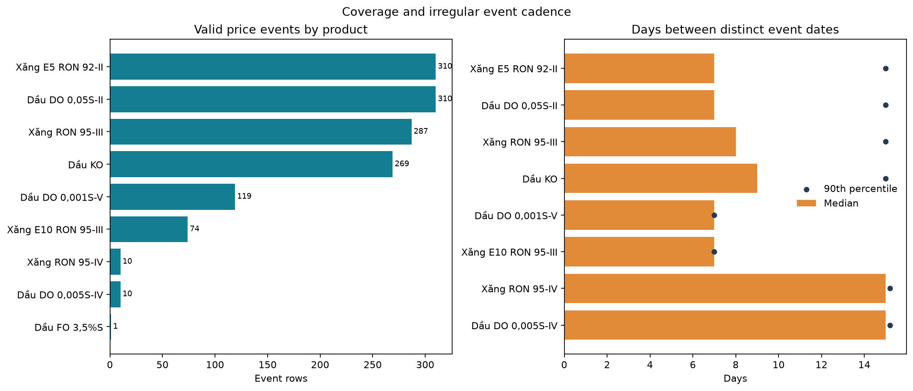
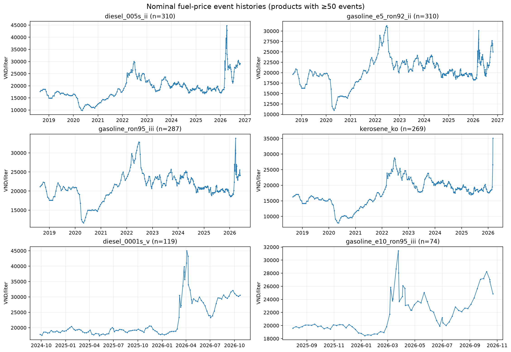
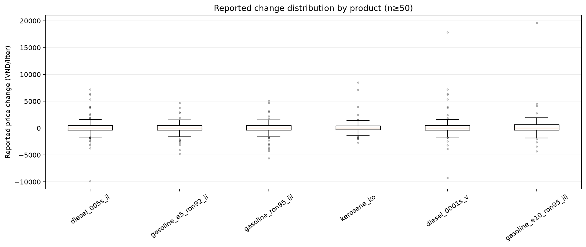
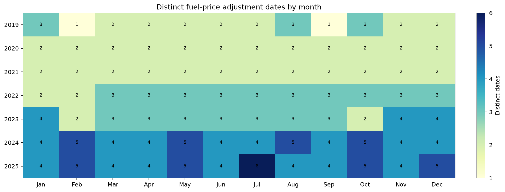
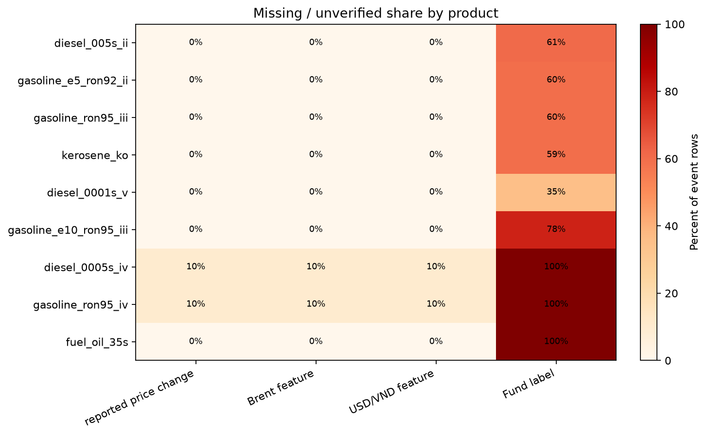
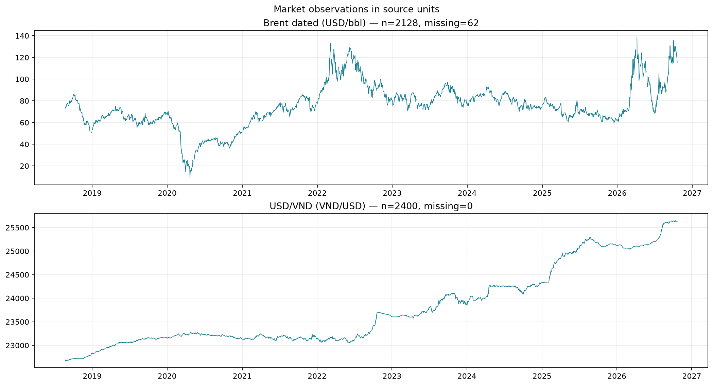
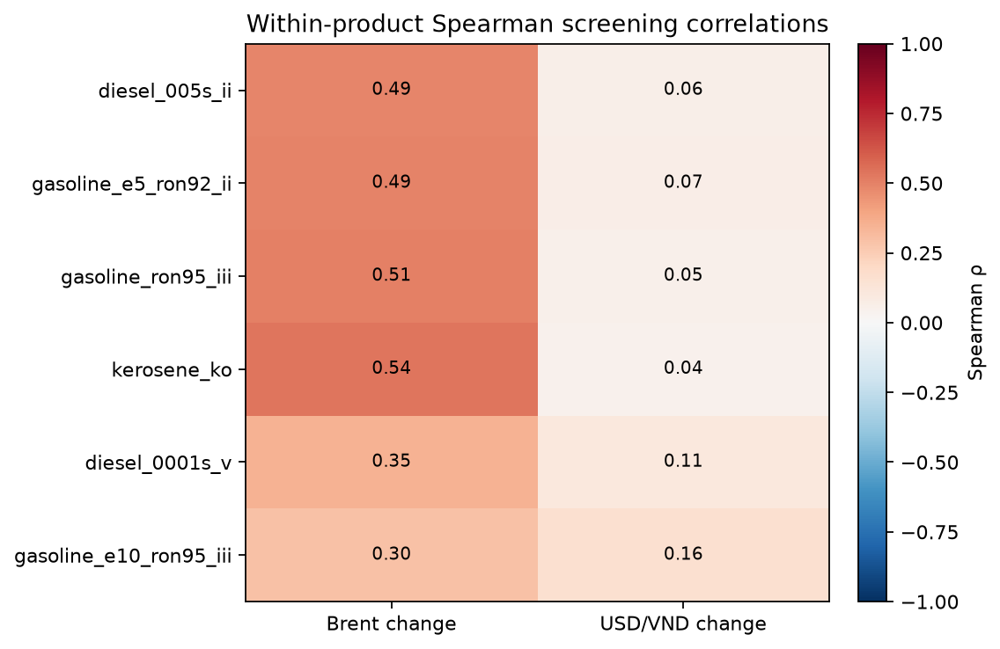

# PetroTwin EDA — M2 T10/T11

**Run:** `28b22922e761cb08a8d8` · **Schema:** `petrotwin-data-v3` · **Window:** 2018-08-22–2026-10-22 
Notebook: [`01_fuel_market_eda.ipynb`](../notebooks/01_eda/01_fuel_market_eda.ipynb) · Database/workflow: [`M2_DATABASE_GUIDE.md`](../docs/M2_DATABASE_GUIDE.md)

## Snapshot in brief

- **1,390 valid fuel events** over **310 distinct adjustment dates**. Events are irregular; do not expand them to daily rows.
- Source change values: **666 increases, 653 decreases, 65 unchanged, 6 missing**.
- Market data: **2,128 Brent** (62 explicitly missing) and **2,400 USD/VND** rows. Six earliest fuel events have no strictly prior market observation; panel features remain NULL.
- Fund label is verified for **565 events** (130 positive, 435 confirmed zero); **825 are unverified**, not zero.
- **64 zero-price FO rows** remain quarantined; FO 3%S has no accepted price event. The pre-EDA gate recorded 0 FAIL and 1 WARN (source reuse terms need verification).

## Product coverage and distributions

Prices are nominal VND/liter; no inflation adjustment is applied. Gap metrics use distinct event dates for each product. Sparse or discontinued products are descriptive only.

| Product | Events | Median price | Observed range | Median event gap | Fund unverified |
|---|---:|---:|---:|---:|---:|
| Diesel 0.05S-II | 310 | 18,980 | 9,850–44,780 | 7 days | 61% |
| E5 RON 92-II | 310 | 20,500 | 10,940–31,300 | 7 days | 60% |
| RON 95-III | 287 | 21,230 | 11,630–33,840 | 8 days | 60% |
| Kerosene | 269 | 18,620 | 7,880–35,090 | 9 days | 59% |
| Diesel 0.001S-V | 119 | 19,360 | 17,430–44,980 | 7 days | 35% |
| E10 RON 95-III | 74 | 21,315 | 18,460–31,420 | 7 days | 78% |
| Diesel 0.005S-IV | 10 | 17,920 | 14,950–18,660 | 15 days | 100% |
| RON 95-IV | 10 | 21,315 | 17,800–22,540 | 15 days | 100% |
| FO 3.5%S | 1 | 17,530 | 17,530–17,530 | — | 100% |

## Calendar, quality, and market context

Distinct adjustment dates average about **2–3 per month in 2019–2021**, increasing to roughly **4–5 per month in 2024–2025**. That change in cadence should be considered before choosing a seasonal baseline. It does not prove a monthly seasonal effect.

## T11 screening and handoff

Within-product Spearman correlations between reported price changes and changes in the strictly prior market values are positive/moderate for Brent (**ρ≈0.30–0.54**) and weaker for USD/VND (**ρ≈0.04–0.16**) for products with at least 50 events. These are **exploratory associations, not causal estimates or forecast validation**. Event gaps differ, domestic price controls and taxes intervene, and the selected prior observation alone does not prove that its publication was available at a real forecast cutoff.

Before feature engineering, M3 and the team still need to agree on the target (price level or reported change), forecast origin/as-of rule, and horizon. Do not infer E10 from RON95, convert unverified fund labels to zero, or use quarantined rows. Verify source reuse terms and confirm the zero-price FO interpretation with PVOIL before automating new source intake.
